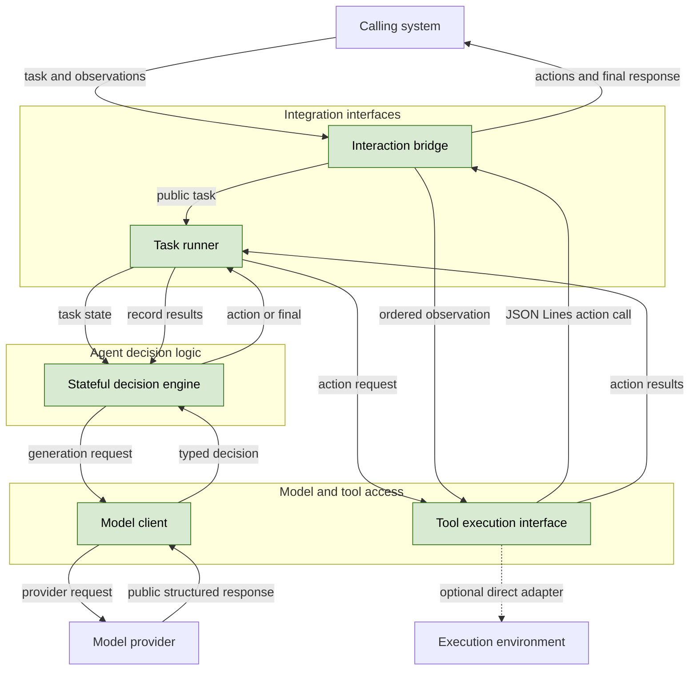
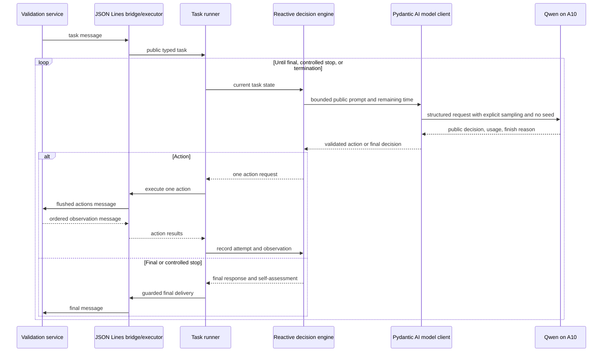

## Baseline AppWorld agent

### 1. Executive summary

#### 1.1 Spec description

Implement an installable `reliable_agent_appworld` agent that completes validation episodes through the versioned JSON Lines protocol. The agent will use a stateful, reactive ReAct loop to request one `execute_code` action at a time, learn from public observations, and return explicit completion and self-assessment. It will include bounded context and logs, absolute-deadline enforcement, controlled failure responses, typed configuration, and provider-independent tests. The baseline establishes a measurable implementation; it does not assume that the overall project acceptance thresholds will already be met.

The selected design and supporting evidence are recorded in `../investigations/baseline-solution.md`.

#### 1.2 Spec motivation

The project has a validated AppWorld execution boundary but no real solution implementation. A small reactive baseline is needed to measure task success, error awareness, repeat behavior, and latency before considering more complex reliability mechanisms. Reusing generic infrastructure lessons from the related reliable-agent project reduces protocol risk, while a new decision policy avoids importing PDDL-specific behavior.

#### 1.3 Implementation repos

https://github.com/anton-pershin/reliable-agent-appworld — management and implementation repository.

### 2. Requirement analysis

#### 2.1 Functional requirements

- **FR1. Installable episode process.** Provide Python packaging with all runtime dependencies and prompt resources declared. Support `python -m reliable_agent_appworld` and a console entry point in an empty working directory. Accept typed CLI and environment overrides, validate the effective configuration, and expose it without credentials.
- **FR2. Versioned interaction bridge.** Implement protocol version 1 over standard input/output: read one task, emit nonempty action calls with unique string call IDs, match each observation to its call and results, and emit one final response. Standard output must contain protocol messages only. `Task.input` remains a string at the reusable boundary; the AppWorld bridge decodes its public JSON payload without giving the decision engine access to private data.
- **FR3. Reactive decision engine.** Use Pydantic AI structured decisions to choose either the next action or a final response. For each action turn, select one supplied tool with schema-valid arguments; for AppWorld this is one small, inspectable `execute_code` step. Preserve episode-local task state and action/observation history. Use public API discovery and execution feedback rather than planners, reference answers, private evaluation, or benchmark-specific solvers.
- **FR4. Context management.** Always retain the original public task, instructions, tool descriptions, and recent interaction evidence. Bound individual observations and total history with configurable character budgets, preserving multiline Unicode safely. Record omitted or truncated content explicitly in logs and expose a concise trim marker to the model. A formatting or execution error must remain available as feedback for the next decision.
- **FR5. Completion and self-assessment.** Permit a final decision only with an explicit completion declaration, string answer and reason, finite confidence in `[0,1]`, and a strict boolean `likely_incorrect`. AppWorld instructions must require `apis.supervisor.complete_task(...)`, including a direct answer when requested, before the protocol final. Controlled stops caused by errors or budgets must return `completed=false`, low confidence, `likely_incorrect=true`, and a public reason without another model request.
- **FR6. Model access and sampling.** Default to `openai:qwen/qwen3.5-9b` through the OpenAI-compatible environment configuration. Use Qwen's precise-coding sampling as the initial configuration: temperature `0.6`, top_p `0.95`, top_k `20`, min_p `0`, presence penalty `0`, repetition penalty `1.0`, and at most `4096` generated tokens. Never configure a random seed. Capture public output, usage, finish reason, and available model/provider metadata. Bound structured-output repairs and provider retries by the same absolute deadline.
- **FR7. Deadline and execution budgets.** Maintain one monotonic episode deadline and configurable action, model-request, and final-response budgets. Initial defaults are 285 seconds internally, 50 action attempts, 120 seconds per model request, and a 25-second final-response reserve; callers may override them. Check remaining time across generation, repairs, retries, action writes, observation reads, cancellation, and final delivery. Do not exhaust the AppWorld interaction limit without first attempting a controlled final.
- **FR8. Task runner and tool execution interface.** Provide an asynchronous runner that owns complete episode execution and depends on an abstract tool executor. The JSON Lines executor implements that interface for caller-controlled environments, maintaining one outstanding call and returning ordered observations. Nontransient execution failures are feedback to the model; cancellation, protocol failure, and uncertain side effects must not be treated as successful completion.
- **FR9. Observability and diagnostics.** Write ordered structured events to standard error with episode/event identifiers, elapsed time, configuration and dependency provenance, public task/action/observation data, model requests and public responses, truncation, retries, repairs, budgets, termination, and self-assessment. Support configurable detail and redact credentials. Bound individual payloads and total emitted bytes so logging cannot exceed validator output limits; record suppression/truncation explicitly.
- **FR10. Operations documentation.** Document installation, local model-stub tests, CLI/environment configuration, the protocol boundary, sampling behavior, security/privacy assumptions, and full/partial validation invocation. Do not duplicate the validator's registered task catalog or thresholds.

#### 2.2 Non-functional requirements

- **NFR1. Layering and low coupling.** Preserve the constitution's integration, decision, and model/tool-access layers. The engine and runner must not import AppWorld or validator code and must work with generic tools and model/executor test doubles.
- **NFR2. Simplicity.** Use one reactive decision path with one action per turn. Do not add planning, voting, reviews, transition learning, formal goal parsing, dynamic demonstrations, or speculative batching.
- **NFR3. Robustness and testability.** Handle malformed model/provider output, tool errors, cancellation, timeouts, and stream failures without contaminating the protocol. Use deterministic test doubles and fake clocks for fast unit tests, plus real subprocess tests for transport behavior.
- **NFR4. Privacy and resource bounds.** Never intentionally access or log private evaluation data or credentials. Do not retain private model reasoning. Bound context, generated output, standard error, and concurrent operations; validation runs use one in-flight episode process unless explicitly configured otherwise.
- **NFR5. Reproducible evidence.** Tests and validation records must identify the exact implementation and relevant runtime/model versions. Diagnostic partial runs and authoritative full runs must remain clearly distinguished.

### 3. Acceptance criteria

- **AC1. Contracts and configuration.** Unit tests cover valid/invalid tasks, strict booleans, finite confidence, tool schemas, AppWorld public-input decoding, CLI/environment precedence, credential-safe effective configuration, and the absence of a configured seed. Invalid configurations fail before provider calls.
- **AC2. Reactive engine and model client.** Pydantic AI `FunctionModel`/`TestModel` and scripted provider tests cover action then observation then final, schema-validation repair, code/execution-error feedback, premature completion, controlled stops, sampling fields, no seed, public metadata capture, and absolute-deadline behavior across retries and repairs.
- **AC3. Context and observability bounds.** Tests include large and multibyte observations, old-history trimming, retained trim markers, ordered action/result history, credential redaction, payload caps, total log-byte caps, and explicit truncation/suppression events. No test may emit protocol logs on standard output.
- **AC4. Runner and installed-process protocol.** Tests prove one outstanding call, unique IDs, ordered result matching, failed action accounting, cancellation/timeout cleanup, final delivery after pending writes, and controlled final responses. A clean non-editable installation must pass a subprocess episode against a local fake OpenAI-compatible provider and fake executor, including AppWorld-shaped public input and `execute_code` observations.
- **AC5. Real validator smoke.** On train task `82e2fac_1`, run one model-backed partial-validation episode with AC1/AC2/AC7 selected. The run must complete without infrastructure failure or malformed protocol output and must compute every selected metric. Inspect only public protocol/model/log evidence and aggregate results.
- **AC6. Repeated dev diagnostic.** Run the selected implementation on all three variants of dev scenarios `50e1ac9` and `fac291d`, two repeats, with AC1/AC2/AC3/AC7 selected. The run must complete with no infrastructure failures and every criterion at least valid. Record its run ID/directory and public diagnostics in the investigation; no project-level acceptance threshold is imposed by this increment.
- **AC7. Quality and packaging.** Run the complete unit/integration suite, Ruff, a source/wheel build, and clean wheel installation smoke. All must pass without network access to private services or real provider calls in the standard test suite.
- **AC8. Durable documentation.** README, spec, investigation, and validation history must describe the implemented behavior and evidence accurately. Any changed experiment scope or deferred requirement must be recorded explicitly rather than silently omitted.

### 4. High-level solution design

All five constitution components are created in this increment. The integration bridge implements caller-controlled AppWorld execution through the generic runner and tool executor; no component runs AppWorld inside the solution process.

The direct tool-environment adapter is optional for other callers. Validation uses the JSON Lines executor and external AppWorld worker; private evaluation remains outside the diagram's solution boundary.

### Component responsibilities

- `contracts.py`: strict task/tool/action/observation/final models, internal decisions and attempts, task state, and typed configuration.
- `config.py`: CLI/environment parsing and semantic validation; provider credentials remain environment-only.
- `model.py`: Pydantic AI structured action/final generation, ReAct instructions, bounded public prompts, sampling, repairs, and metadata without private reasoning.
- `engine.py`: reactive decisions, action-schema checks, history trimming, completion rules, and controlled stops.
- `runner.py`: asynchronous episode state machine, action execution, accounting, deadlines, and cancellation.
- `protocol.py`: strict JSON Lines messages, bounded flushed I/O, call/observation correlation, and guarded final writes.
- `observability.py`: ordered redacted structured events with payload and total-byte bounds.
- `__main__.py`: configuration, component assembly, one-episode execution, and controlled process termination.
- `prompts/react.txt`: packaged concise public-API discovery and interactive-code guidance.
- `tests/`: contract, model, engine, runner, logging, regression, subprocess, and clean-install checks with no real provider dependency.
