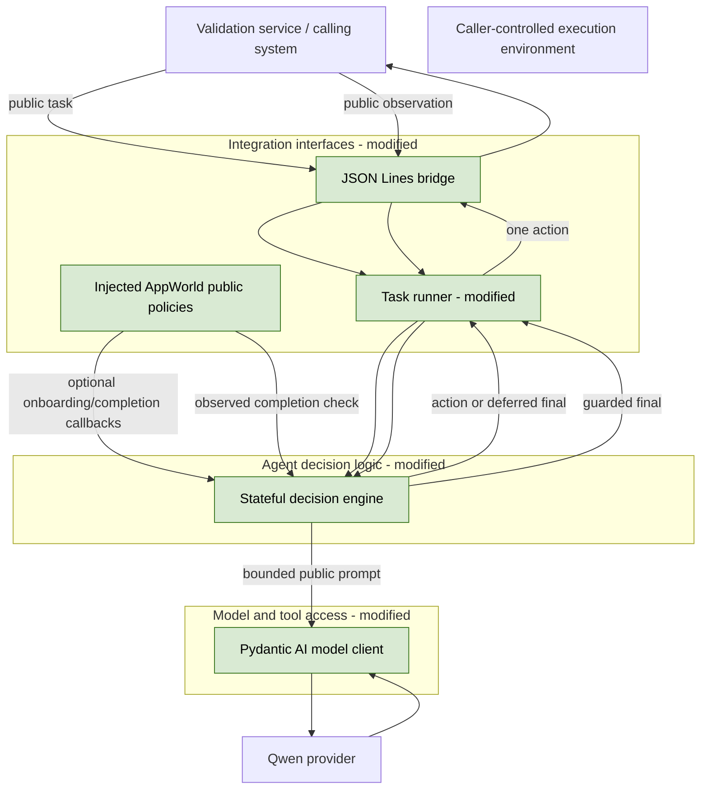
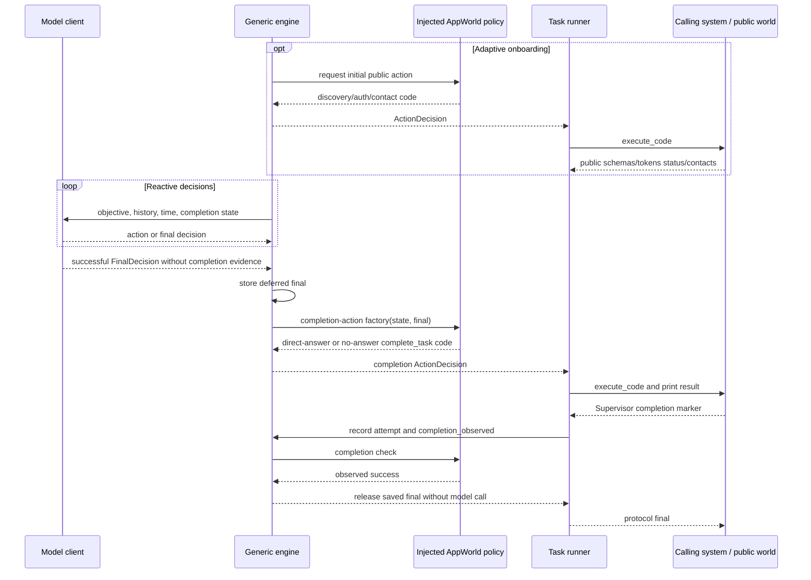

## Verified reactive accuracy improvements

### 1. Executive summary

#### 1.1 Spec description

Improve the merged reactive agent's AppWorld task success by making public discovery, authentication, completion, direct-answer, and finalization behavior reliable by default. The implementation will retain one-code-action ReAct decisions while adding injected public onboarding/completion policies, observed-completion gating, concise answer normalization, exact-target guidance, and a bounded final-decision phase. It will preserve the existing protocol, privacy, deadline, and installed-package guarantees and will document remaining accuracy and repeat-consistency gaps.

The selected design and all positive/negative experiments are recorded in `../investigations/baseline-solution.md`.

#### 1.2 Spec motivation

The merged baseline completed 630 measurable episodes without infrastructure failures but solved no tasks. Public trajectory analysis found systemic model timeouts, almost no successful `complete_task` use, excessive discovery/authentication work, and lost or unsupported completion claims. Focused partial-validation candidates demonstrated genuine task successes after deterministic completion and public onboarding; this increment freezes the best completed S2/S3 candidate into the reusable default rather than leaving it as experimental overrides.

#### 1.3 Implementation repos

https://github.com/anton-pershin/reliable-agent-appworld — management and implementation repository.

### 2. Requirement analysis

#### 2.1 Functional requirements

- **FR1. Validated default configuration.** Default to thinking-enabled Qwen sampling without a seed; 180-second internal episode budget, 60-second single model-request cap, 1024 output tokens, no identical outer provider retries, 30 actions, 15-second final-response reserve, and 35-second decision reserve. Retain CLI/environment overrides and credential-safe effective-configuration logging.
- **FR2. Generic injected completion policy.** Keep the reusable engine independent of AppWorld by depending on optional completion-check, bootstrap-action, and completion-action callbacks. Generic tasks without injected policies retain the existing public-attempt completion behavior. Do not import AppWorld into engine, runner, contracts, or model code.
- **FR3. Observed AppWorld completion.** Recognize successful completion only when Python syntax identifies an actual `apis.supervisor.complete_task(...)` call and its corresponding public result contains the Supervisor completion marker. Ignore comments, documentation strings, failed calls, and `status="fail"`. Preserve `completion_observed` in task state and prompts even after history trimming.
- **FR4. Deferred and automatic completion.** Save a model's successful final as a deferred final until public completion evidence exists, but never automatically complete a zero-work success claim. When automatic completion is enabled after public work, translate the success claim directly into one completion action rather than repeatedly asking the model to comply. Bind the deferred final to that specific completion call; failed, uncertain, or superseding actions invalidate it. Release the saved final without another provider request only after matching observed success; never release it after an uncertain or failed completion action.
- **FR5. Direct-answer semantics.** For answer-seeking objectives, pass a concise scalar/entity to `complete_task`; for action-only objectives, omit the answer. Normalize surrounding quotes, numeric/currency answers, units for numeric questions, and explanatory Who-answer suffixes/prefixes using deterministic public-string rules. Keep protocol final answers as strings and do not use reference answers or private scoring feedback.
- **FR6. Adaptive public onboarding.** Before the first model decision, optionally execute one deterministic public API-discovery action for private-context or action-only objectives. Skip onboarding for public answer lookups. Use the objective with `search_api_docs`, print compact schemas, restrict login work to task-relevant public app aliases, and retain the no-onboarding path when the objective is not suitable.
- **FR7. Permitted authentication and relations.** Retrieve Supervisor profile/account-password data through public APIs, use phone number only for phone login and email for other supported apps, save tokens in `access_tokens`, and print status rather than secrets. For relationship objectives, authenticate phone and prefetch compact contact names/contact details/relationships using the documented token. Reject obvious raw-requester/HTTP, credential-printing, raw-login-response, and `import apis` actions at the integration policy boundary; never print raw failed login/contact payloads. Do not use private files, credentials outside the permitted public task boundary, or task-ID-specific branches.
- **FR8. Reactive task guidance.** Render the actual objective as a first-class prompt field. Require printed write responses and public-state verification, exact matching of all qualifiers for singular targets, `DateTime.now()` for environment time, explicit contact filtering, pagination, and concise entity/numeric answers. Preserve the concise ReAct prompt; do not restore the rejected long worked-example prompt or add planners/voting.
- **FR9. Finalization under budgets.** Permit final-only decisions when actions are exhausted or the decision reserve begins. Gate bootstrap and ordinary actions by that permission, bound ordinary generation/execution at the reserve boundary, and re-check permission after generation before every action. Ordinary actions must not execute in final-only mode; a typed generated automatic-completion action may still execute within the shared deadline. Release a deferred successful final even when it follows the last permitted action. Controlled failure responses remain timely and strictly flagged.
- **FR10. Recoverable public context.** Decode structured task input for prompting, preserve structured status/error fields, and truncate oversized observations with head/tail markers so traceback endings and recovery clues survive. Preserve existing bounded logs, redaction, protocol output reserves, cancellation, and nonblocking stdio behavior.
- **FR11. Default installed-process lifecycle.** A clean non-editable installation must execute the default sequence of public onboarding, model work, completion, observation, and protocol final with protocol-only stdout. Pydantic AI banners, dependency logs, and credentials must not contaminate the interaction channel.

#### 2.2 Non-functional requirements

- **NFR1. Layering and low coupling.** AppWorld-specific syntax, answer, discovery, authentication, and contact policies remain in integration/policy code. The generic engine depends only on injected callables and typed state.
- **NFR2. Simplicity.** Keep one reactive path and one outstanding action. Do not add planning, voting, formal goal parsing, dynamic task solvers, reference-answer lookup, or private-evaluation adaptations.
- **NFR3. Robustness and testability.** Use deterministic fake models/executors, AST and answer-contract tests, fake clocks, subprocess providers, and installed-wheel tests on Python 3.11–3.13 and Pydantic AI 2.66/2.74. Preserve the shared absolute deadline and fail-closed protocol behavior.
- **NFR4. Privacy and reproducibility.** Use public task/API evidence only, no fixed seed, no disabled continuous batching, no private evaluator reports, and no committed credentials. Record exact commits, run IDs, populations, overrides, and negative results.
- **NFR5. Honest acceptance.** Partial validation is diagnostic. The increment may merge with project AC1/AC3 still valid rather than accepted, but must not describe itself as an accepted project implementation or as consistently solving all task families.

### 3. Acceptance criteria

- **AC1. Contracts and defaults.** Unit tests cover selected defaults and overrides, absent seed, completion AST recognition, rejected comments/docs/fail calls, direct-answer/action-only semantics, Who/numeric/currency extraction, adaptive public/action/private routing, relevant-app aliases, phone/email login selection, relation contact prefetch, and secret-free generated code.
- **AC2. Engine, runner, and recovery.** Tests cover deferred-final hold/release, automatic completion without an extra model decision, failed/uncertain completion, last-action finalization, final-only action rejection, decision-reserve transition, single model timeout policy, exact objective rendering, structured head/tail observation truncation, and completion milestone retention.
- **AC3. Installed default process and CI.** A clean wheel episode without `PYTHONPATH` exercises default onboarding, work, automatic no-answer/direct-answer completion, observation, and saved final delivery with no banner or credential leakage. All six Python/Pydantic AI CI jobs pass tests, Ruff, builds, wheel episodes, and both entry points.
- **AC4. Model-backed diagnostic evidence.** Retain selected-candidate S2 run `20261126T111210-485860Z-a62eb5761864` (2/12 successes) and S3 run `20261126T112911-243164Z-b162cf5d36ac` (4/12 successes, AC3 valid) with public trace analysis. On the final default revision, run a frozen model-backed partial check with all four criteria; every criterion must be at least valid, no infrastructure failure may occur, and at least one genuine task success with public completion evidence must be observed. A full-validation run is not a substitute for this focused check.
- **AC5. Independent engineering review.** Review the layering, completion/answer correctness, privacy, default lifecycle, deadline/cancellation behavior, tests, and spec/documentation consistency. Resolve every no-pass item and rerun affected local/partial gates.
- **AC6. Authoritative full validation.** After final partial checks and review, run the unchanged registered `appworld` full profile on the latest reviewed revision. Append the terminal run to `.internal/validation-results.md`; the latest result must be at least valid before PR integration. Do not require or claim overall project acceptance in this increment.
- **AC7. Durable documentation.** README, terminology, spec, investigation, and PR evidence must describe defaults, invocation, genuine successes, negative candidates, task-family gaps, incorrect confident completions, repeat variance, and run directories accurately.

### 4. High-level solution design

This increment modifies the existing integration bridge/policy assembly, stateful decision engine, task runner, and model prompt/configuration. It does not change the constitution's three-layer architecture or move AppWorld execution/private scoring into the solution.

The injected policy functions live with protocol integration; callback invocation and deferred state remain generic. The final-response reserve is for delivery, while the decision reserve is the preceding final-only model phase. All phases continue to use the same absolute episode deadline.
