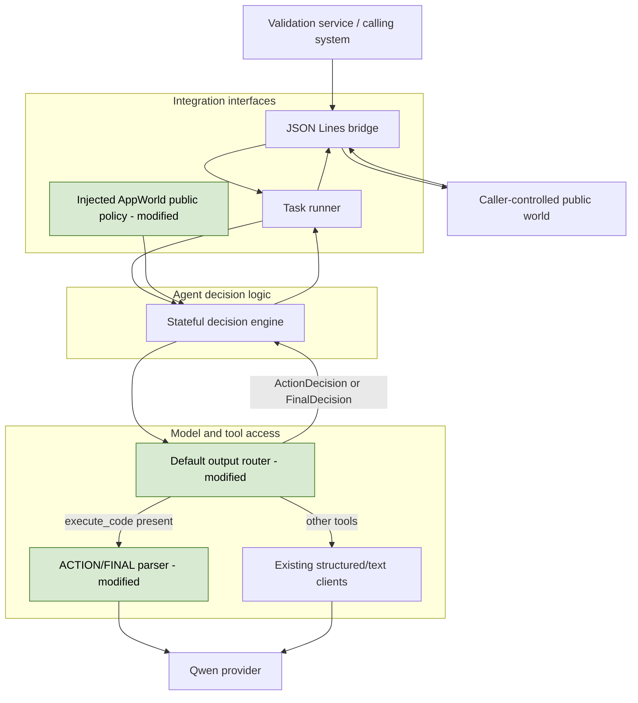
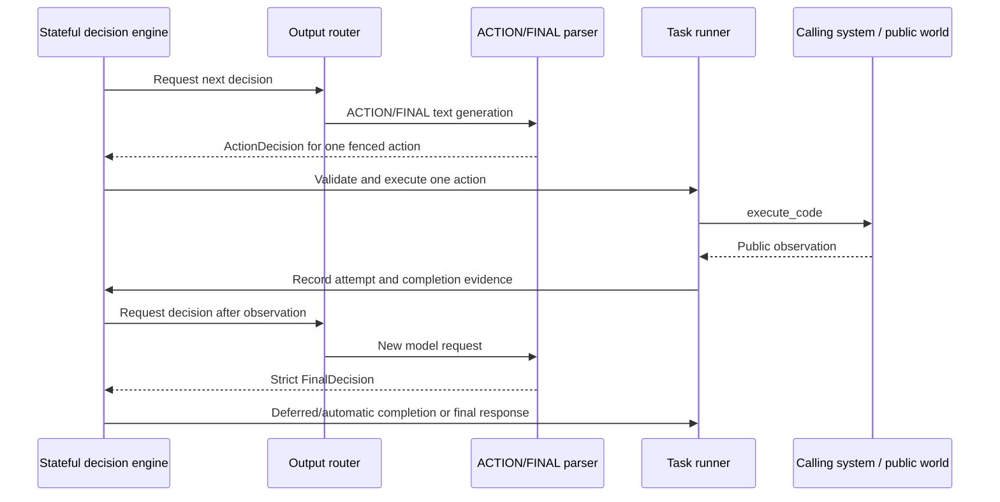

## Fenced reactive accuracy and decision throughput

### 1. Executive summary

#### 1.1 Spec description

Make action-first fenced-code decisions the installed default for tasks that supply `execute_code`, while preserving structured decisions for other tools. Increase the default episode budget to 240 seconds, retain the 60-second model-request cap and 1024 output tokens, and add generic public-objective app coverage, answer/action classification, and source/aggregation guidance. Preserve the existing reactive engine, observed completion, privacy, cancellation, and controlled-final contracts.

The selected design and its negative and positive experiments are recorded in `../investigations/baseline-solution.md`, especially E50–E66 and `../investigations/evidence/accuracy-issue6-partial-results.json`.

#### 1.2 Spec motivation

The latest authoritative full run measured overall success 0.13016, far below project AC1 and the issue-6 intermediate target of 0.3. Residual analysis found early model/output stops, low decision yield, multi-app coverage defects, and incorrect completions. Bounded partial validation showed that action-first fenced code with a 240-second episode scored 4/6 on the frozen train screen and 8/24 = 0.3333 on the frozen repeated dev screen, with accepted AC2/AC3/AC7 and no infrastructure failures. This increment must determine whether that mechanism reaches at least 0.3 on the authoritative full population.

#### 1.3 Implementation repos

https://github.com/anton-pershin/reliable-agent-appworld — management and implementation repository.

### 2. Requirement analysis

#### 2.1 Functional requirements

- **FR1. Default output routing.** Keep `output_mode="auto"` as the public default. In auto mode, select fenced-code decisions when the supplied tools contain `execute_code`; retain the existing structured-output path for tasks without that tool. Explicit `tool` and `text` modes retain their existing behavior. Explicit `code` mode requires `execute_code` and must fail in a controlled way when it is absent. Do not require output-mode overrides during validation.
- **FR2. Fenced action contract.** For the next action, accept one `ACTION` marker line followed by exactly one complete, nonempty fenced Python code block. Parse the code with `ast.parse` and return the existing `ActionDecision` for `execute_code`. Reject missing, partial, empty, syntactically invalid, or multiple code blocks through the existing bounded repair path. Do not execute more than one action from a model response.
- **FR3. Action-first and final behavior.** If a valid action precedes a trailing `FINAL`, execute the action and request the final again after its public observation. Do not release or persist the trailing final as if the action had already executed. Accept marker lines with trailing prose such as `FINAL with one JSON object:` and parse the following JSON. A final that precedes an action must not silently discard that intended action.
- **FR4. Strict final self-assessment.** Parse `FINAL` into the existing `FinalDecision`, including strict booleans, finite numeric confidence, and a short reason. Normalize a numeric JSON `answer` to the protocol's string representation without changing numeric answer normalization for the separate AppWorld `complete_task` call. Invalid final responses use bounded repair and then a controlled failure. Do not retain private model reasoning.
- **FR5. Public-objective app coverage.** Determine onboarding apps from generic explicit and implicit aliases rather than only the applications returned by document search. Cover existing app names, `SimpleNote` variants, file paths, phone alarms/messages, music collections, and payment/money terms. Preserve relevant-app restrictions, relationship-based phone contact prefetch, the existing four-app limit, and secret-free status output.
- **FR6. Answer/action and collection semantics.** Recognize `Name` as an answer imperative, and distinguish rating actions from rating filters or ordering so direct answers are preserved. Retain concise direct-answer and no-answer completion behavior. Prompt for retrieval of the named source collection before item filtering, coverage of every requested source, stable-ID deduplication for unique counts, compact metric calculations, and rankings based on the requested metric rather than response order. Do not add task-ID branches or benchmark-specific solvers.
- **FR7. Budgets and sampling.** Default to a 240-second internal episode, the existing 60-second model cap, 1024 output tokens, 30-action ceiling, 35-second decision reserve, and 15-second final-response reserve. Retain thinking and the current Qwen sampling settings. Do not set a model seed or disable continuous batching. The 240-second internal limit must remain below the validator's 300-second timely-response limit.
- **FR8. Existing completion and failure contracts.** Preserve deferred finals, automatic direct-answer/no-answer completion, observed public completion checks, final-only behavior, action validation, and controlled `completed=false, likely_incorrect=true` stops. The output parser must not bypass credential, raw-requester, schema, cancellation, or unknown-outcome protections.
- **FR9. Documentation and observability.** Document auto routing, the ACTION/FINAL contract, the 240-second default, and remaining accuracy limitations. Keep logs bounded and credential-safe. Record exact commits, run IDs, partial/full scope, populations, overrides, and negative results. Do not claim that public completion proves task correctness.

#### 2.2 Non-functional requirements

- **NFR1. Layering and low coupling.** Reuse the existing decision, engine, runner, and protocol types. Do not import AppWorld into the reusable engine, runner, contracts, or model client. Output selection depends only on supplied tool descriptions.
- **NFR2. Simplicity.** Preserve one reactive loop and one outstanding action. Do not add planning, voting, dynamic task solvers, a second completion policy, or a general text-to-code inference layer beyond the explicit ACTION/FINAL parser.
- **NFR3. Robustness and testability.** Use deterministic fake models, fake public APIs, a fake OpenAI-compatible provider, and installed-wheel subprocess tests. Cover malformed output, repairs, annotated markers, action-first responses, numeric answers, missing tools, timeouts, and secrets. Keep both Pydantic AI 2.66 and 2.74 supported.
- **NFR4. Privacy and reproducibility.** Use public task/API evidence only. Do not inspect or retain private evaluator reports, reference answers, hidden task metadata, or credentials. Preserve no-seed and continuous-batching constraints.
- **NFR5. Honest acceptance.** Partial validation is diagnostic only. Issue 6 requires full-population VM1 >= 0.3, which remains below project AC1. AC2 and AC3 may be valid rather than accepted, but no criterion may be invalid. Document any regression of currently accepted AC2, AC3, or AC7.
- **NFR6. Time and cost.** Use frozen small partial populations for iteration. Run the unchanged full profile only after local checks, exact-default partial confirmation, and independent review. Retain the longer runtime as an explicit cost and do not start parallel full runs.

### 3. Acceptance criteria

- **AC1. Output routing and parser tests.** Tests prove auto routing with and without `execute_code`, explicit mode behavior, one fenced action, AST validation, bounded repairs, action-first ACTION+FINAL handling, annotated markers, strict final validation, numeric protocol-answer strings, and controlled missing-tool behavior. Existing model, engine, runner, and protocol tests remain green.
- **AC2. Policy, defaults, and installed process.** Tests cover generic aliases, Name/rating classification, source/aggregation instructions, the 240/60/1024 defaults, and absent model seed. A clean non-editable wheel executes private-action and private-answer default episodes with ACTION/FINAL provider responses, automatic completion, protocol-only stdout, and no credential leakage. All six Python 3.11–3.13 × Pydantic AI 2.66/2.74 CI jobs pass tests, Ruff, builds, installed-wheel episodes, and both entry points.
- **AC3. Exact-default model-backed confirmation.** Retain investigation train run `20261127T205551-981539Z-a1d1d241bd55` (4/6) and dev run `20261127T205552-018995Z-1c6a719a5f4b` (8/24). After final code and review changes, rerun the frozen 24-episode dev population on the exact reviewed revision using only `--log-level ERROR`. The run must complete with no infrastructure failures, every selected criterion at least valid, overall success >= 0.3, and at least one multi-app success. Partial evidence does not certify project acceptance.
- **AC4. Independent engineering review.** Review output routing, parser safety, layered boundaries, completion/final semantics, privacy, deadlines, default lifecycle, tests, and spec/documentation consistency. Resolve every no-pass item and rerun affected local and partial gates. An advisory item may remain only with an explicit rationale.
- **AC5. Authoritative full validation.** Run the unchanged registered `appworld` full profile on the latest reviewed implementation using only `--log-level ERROR`. The terminal run must have no infrastructure failures; AC1/AC2/AC3/AC7 must all be accepted or valid; and `VM1/unperturbed_overall_success_rate` must be >= 0.3. Append the terminal run to `.internal/validation-results.md`. If VM1 is below 0.3, this spec is not satisfied and implementation or scope must be revised before review readiness.
- **AC6. Durable documentation and evidence.** Update README, the active investigation, spec links, and full-validation history. Record selected and rejected candidates, exact default/partial/full revisions, remaining source-filtering and multi-app gaps, AC2 margin, and runtime cost accurately. Never replace an earlier full-run entry.

### 4. High-level solution design

This increment modifies model access, default configuration, the public prompt, and injected AppWorld public policy. It retains the constitution's three-layer architecture and caller-controlled execution/private scoring boundary.

The model client owns output translation only. The generic engine continues to own task state, deferred completion, and controlled failure. AppWorld integration owns public app aliases and completion recognition. No private evaluator feedback enters any component.
